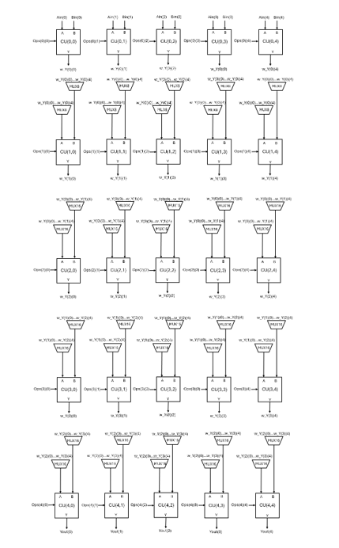
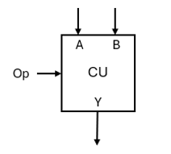
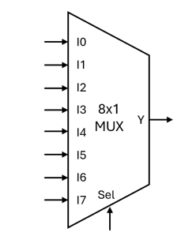
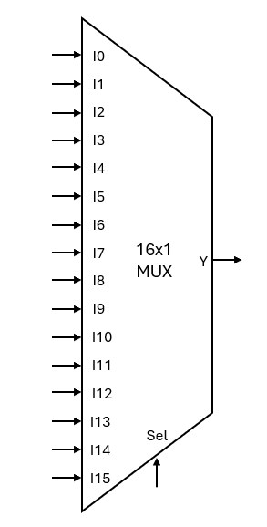
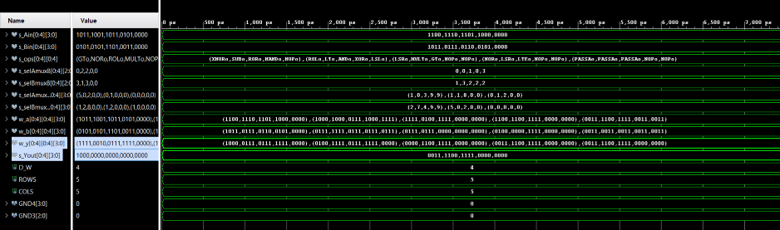

# Reconfigurable Computing Fabric

## Overview

A VHDL implementation of a coarse-grained reconfigurable computing fabric designed to support configurable, multi-stage dataflow computation. The architecture consists of a 5×5 grid of computational units (CUs), each capable of performing 24 selectable operations.

The design enables different computational dataflow graphs (DFGs) to be mapped onto the same hardware architecture by configuring individual CU operations and inter-unit connections.

## Key Features

- 25 interconnected computational units
- 24 selectable operations per computational unit
- Configurable inter-unit routing
- Parameterized data width with a default of 4 bits
- Five-stage computational dataflow
- Modular and hierarchical RTL design
- Functional verification using VHDL testbenches

## System Architecture

The architecture consists of five rows and five columns of computational units.

- **Row 0:** Receives external input operands.
- **Row 1:** Selects operands from the preceding row (parent) using 8-to-1 multiplexers.
- **Rows 2–4:** Select operands from the preceding two rows (parent and grandparent) using 16-to-1 multiplexers.
- **Final output:** Consists of five results generated by the final row.

This routing architecture enables flexible data dependencies across computational stages, allowing different computational dataflow graphs to be implemented without modifying the underlying hardware.

## Computational Unit

Each computational unit is implemented as a parameterized combinational logic module that accepts two input operands (A and B) and an operation selection signal (Op) to produce a single output (Y).

### Computational Unit Features

- Configurable data width with a default of 4 bits
- 24 selectable operations
- Unsigned arithmetic and comparison operations
- Fixed-width addition and subtraction
- Multiplication with truncation to the configured output width
- Comparison results represented by all-ones (true) or all-zeros (false)
- Variable shift and rotation amounts determined by operand B
- Direct operand forwarding through PASSA and PASSB
- Zero output for NOP

### Supported Operations

| Category | Operations | Count |
|---|---|---:|
| Arithmetic | ADD, SUB, MULT | 3 |
| Logical | AND, OR, NAND, NOR, XOR, XNOR | 6 |
| Comparison | GT, LT, EQ, GTE, LTE, NEQ | 6 |
| Shift | LSL, LSR, ASL, ASR | 4 |
| Rotation | ROL, ROR | 2 |
| Data Transfer | PASSA, PASSB | 2 |
| No Operation | NOP | 1 |
| **Total** | | **24** |

## Configurable Interconnects

The interconnect network uses multiplexers to independently select the two input operands of each computational unit, enabling configurable data routing between computational stages.

### 8-to-1 Multiplexer

Used in Row 1 to select input operands from the outputs of the parent row.

### 16-to-1 Multiplexer

Used in Rows 2–4 to select input operands from the outputs of both the parent and grandparent rows, enabling data dependencies across non-consecutive computational stages.

## Design Methodology

- Hierarchical decomposition into reusable hardware modules
- Parameterized VHDL design using generics
- Custom VHDL package for operation selection and shared type definitions
- Array-based signal organization and indexing
- Combinational computational unit design
- Configurable operand routing and operation selection
- Integration of computational units and multiplexers into a unified architecture
- Functional simulation and RTL schematic analysis
- Manual calculation of expected outputs for verification

## Verification and Results

The architecture was functionally verified using four distinct test cases representing different computational dataflow graphs (DFGs), operand selections, and CU operation configurations.

Expected output values were calculated manually for the computational units involved in each test case and compared against the corresponding simulation results obtained in Vivado.

### RTL Schematic

### Simulation Waveform — Test Case 1

**Simulation interval:** 0–20 ns

### Expected vs. Simulated Results — Test Case 1

All operand and output values are represented in 4-bit binary. CU identifiers indicate the computational units supplying intermediate operands.

| CU | Source A | Source B | Operation | Expected Output | Simulated Output | Match |
|---|---|---|---|---|---|---|
| CU00 | A = 1100 | B = 1011 | XNOR | 1000 | 1000 | ✓ |
| CU01 | A = 1110 | B = 0111 | SUB | 0111 | 0111 | ✓ |
| CU02 | A = 1101 | B = 0110 | ROR | 0111 | 0111 | ✓ |
| CU03 | A = 1000 | B = 0101 | NAND | 1111 | 1111 | ✓ |
| CU10 | CU00 = 1000 | CU01 = 0111 | ROL | 0100 | 0100 | ✓ |
| CU11 | CU00 = 1000 | CU03 = 1111 | LT | 1111 | 1111 | ✓ |
| CU12 | CU01 = 0111 | CU02 = 0111 | AND | 0111 | 0111 | ✓ |
| CU13 | CU00 = 1000 | CU02 = 0111 | XOR | 1111 | 1111 | ✓ |
| CU14 | CU03 = 1111 | CU02 = 0111 | LSL | 0000 | 0000 | ✓ |
| CU20 | CU11 = 1111 | CU12 = 0111 | LSR | 0000 | 0000 | ✓ |
| CU21 | CU10 = 0100 | CU02 = 0111 | MULT | 1100 | 1100 | ✓ |
| CU22 | CU13 = 1111 | CU14 = 0000 | GT | 1111 | 1111 | ✓ |
| CU30 | CU21 = 1100 | CU10 = 0100 | NOR | 0011 | 0011 | ✓ |
| CU31 | CU21 = 1100 | CU20 = 0000 | LSR | 1100 | 1100 | ✓ |
| CU32 | CU13 = 1111 | CU22 = 1111 | LTE | 1111 | 1111 | ✓ |
| CU40 | CU30 = 0011 | CU30 = 0011 | PASSA | 0011 | 0011 | ✓ |
| CU41 | CU31 = 1100 | CU30 = 0011 | PASSA | 1100 | 1100 | ✓ |
| CU42 | CU32 = 1111 | CU30 = 0011 | PASSA | 1111 | 1111 | ✓ |

### Verification Summary

| Test Case | Simulation Interval | CU Outputs Verified | Result |
|---|---|---|---|
| Test Case 1 | 0–20 ns | 18/18 | PASS |
| Test Case 2 | 20–40 ns | 13/13 | PASS |
| Test Case 3 | 40–60 ns | 13/13 | PASS |
| Test Case 4 | 60–80 ns | 13/13 | PASS |
| **Total** | **0–80 ns** | **57/57** | **PASS** |

All 57 reported computational unit output comparisons across the four test cases matched their expected values, demonstrating functional correctness for the tested configurations.

The verification results demonstrate successful operation of the computational units, configurable interconnects, and multi-stage dataflow architecture under the tested configurations.

Additional simulation waveforms are available in the [results](results/) directory. Detailed calculations for all four test cases are provided in the [Design Report](docs/design_report.pdf).

## Repository Structure

| Directory | Contents |
|---|---|
| [`rtl/`](rtl/) | VHDL design source files |
| [`sim/`](sim/) | VHDL testbenches |
| [`docs/`](docs/) | Architecture diagrams and design report |
| [`results/`](results/) | Simulation waveforms and RTL schematics |

## Tools and Technologies

- **Hardware Description Language:** VHDL
- **Development Environment:** AMD Vivado
- **Design:** RTL Design, Digital Logic Design, Combinational Logic
- **Architecture:** Coarse-Grained Reconfigurable Architecture (CGRA), Dataflow Computing
- **Verification:** VHDL Testbenches, Functional Simulation, Waveform Analysis

## Documentation

The complete design methodology, architecture, component specifications, and verification results are available in the [Design Report](docs/design_report.pdf).

## Contributors

- Fariha Rabbi
- Hunter Capulong

Developed as a graduate-level electrical engineering project at the University of North Texas.
